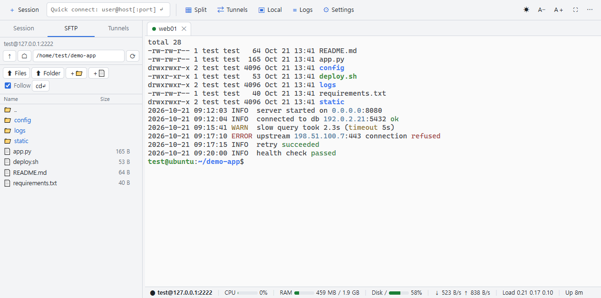
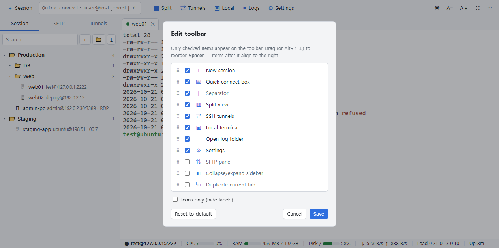
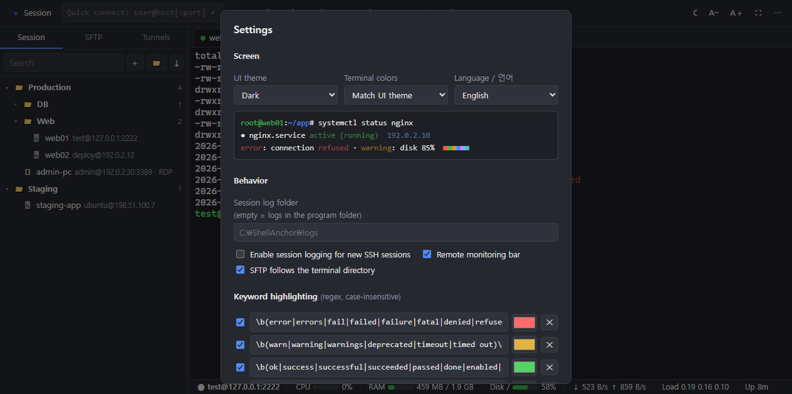

# ShellAnchor

**English** | [한국어](README.ko.md)

A browser-based SSH client focused on the features you actually use every day.
A small relay server (Python) runs on your PC and connects the browser to your SSH servers.

```
Browser (xterm.js) ──WSS── server.py ──SSH── [jump host ──] target server
                              ├─ SFTP / session logs / remote monitoring
                              ├─ SSH tunnels (local forwarding, SOCKS5)
                              ├─ Local terminal (PowerShell / cmd / WSL)
                              └─ RDP → launches Windows Remote Desktop (mstsc)
```



> **Requirements**: Windows 10/11, Python 3.11+ (tested on 3.12), Chrome or Edge.
> The local terminal, RDP launcher and automatic certificate trust are Windows-only. Other operating systems are untested.

## Install

```bat
git clone https://github.com/rorena15/shellanchor.git
cd shellanchor
python -m venv .venv
.venv\Scripts\python -m pip install -r requirements.txt
```

Or just double-click **`run.bat`** — it creates `.venv`, installs the packages if needed, and starts the server.

## Run

```bat
.venv\Scripts\python server.py --open --trust
```

This opens `https://127.0.0.1:8022/` in a Chrome app window.
The first time, Windows asks whether to install a certificate → click **Yes**
(a local CA for this PC only; no browser warnings afterwards).

**Run without a console window** — create a Windows shortcut (.lnk):

| Field | Value |
| --- | --- |
| Target | `<install dir>\.venv\Scripts\pythonw.exe server.py --open --trust --auto-exit` |
| Start in | `<install dir>` |

- If the server is already running, it just opens another window instead of starting a second server
- **Stop**: ⚙ Settings → **Stop server**. With `--auto-exit`, the server also exits one minute after all browser windows are closed (it stays up while an SSH tunnel is running)
- When running without a console, errors are shown in a message box and logged to `data\server.log`

```bat
python server.py --host 0.0.0.0   :: allow other PCs (token required; local terminal and RDP launch are disabled)
python server.py --port 9022      :: different port
python server.py --no-tls         :: plain HTTP (not recommended)
```

## Layout

```
┌ ＋Session ▦Split ⇄Tunnel ▣Local ≡Logs ⚙Settings ────────────── ☀ A− A＋ ⛶ ⋯ ┐
├ [Sessions|SFTP|Tunnels] ┬ tab1 · tab2 · tab3 ───────────────────────────────┤
│ 📁 Ops                   │                                                  │
│   📁 Web                 │   terminal (split: single / 2 cols / 2 rows / 4)  │
│     🖥 web01             │                                                  │
│     🪟 admin-pc          │                                                  │
├──────────────────────────┴ ● root@192.0.2.10 │ CPU ▮▮ 12% │ RAM 2.1/7.7GB │ disk 45% ┤
```

## Features

### Customizable toolbar

Keep only the buttons you need. Click **⋯** at the right end, or **right-click the toolbar → Edit toolbar…**

- Check items to show or hide them, drag (or Alt+↑↓) to reorder. Changes preview live; Cancel restores the previous layout
- Items after the **spacer** are aligned to the right. **Separators** can go anywhere
- Extra actions you can add besides the defaults: SFTP panel, collapse sidebar, duplicate / reconnect / close current tab, new session folder, import MobaXterm sessions
- **Icons only** mode for a compact toolbar (button names appear as tooltips)
- Right-click a button to hide just that one. The layout is saved per browser



### Sessions

- **Session folder tree**: nested folders, drag & drop, search, double-click to connect, context menu (edit / duplicate / delete)
- Session types: **SSH / RDP / local terminal**
- **Import MobaXterm sessions** (⤓ above the tree): pick `MobaXterm.ini` or an exported `.mxtsessions` file
  → imports SSH/RDP sessions with their folder structure (passwords are not imported)
- Passwords are **never stored**. You are asked when connecting, and they are kept only until the window is closed (no re-prompt on reconnect or tab duplicate)
- Private keys are referenced by file path. Encrypted keys prompt for the passphrase on connect. PuTTY `.ppk` must be converted to OpenSSH format
- **Auto-reconnect** on network loss (retries after 3/5/10/20/30 s). Not triggered by an explicit `exit`. On a disconnected tab: `R` = reconnect, `Enter` = close tab
- **Session logs**: enable "Save session log" in the session editor → `logs/<session>/<date_time>_<host>.log` (plain text, color codes stripped). Toolbar ≡ Logs opens the folder

### Terminal

- **Split view** (toolbar ▦): single / side by side / stacked / 4-way. Clicking a tab shows it in the selected pane; new connections fill empty panes first
- **Keyword highlighting**: error·fail·denied (red), warning·timeout (yellow), ok·success (green), IP addresses (blue). Patterns and colors are editable in Settings.
  Only the display is colored — logs and copied text stay unchanged. Not applied in full-screen programs like vim or top
- UTF-8 / EUC-KR encoding, jump hosts
- Copy = select, paste = right-click (Ctrl+Shift+C/V also work)

### SFTP (left sidebar, opens automatically after an SSH login)

- **Follow terminal directory**: `cd` in the terminal and SFTP follows (Linux servers). `cd↵` does the opposite
- **Edit remote files in place**: double-click → editor, Ctrl+S to save. Warns before overwriting if the file changed on the server. Keeps EUC-KR and CRLF
- **Upload/download whole folders**: drag & drop a folder or use `⬆ Folder`. Downloads keep the folder structure
- **Change permissions/owner**: context menu → Permissions / Owner (checkboxes or octal, optionally recursive; changing owner needs root)
- Multi-select (Ctrl/Shift+click), Del to delete (folders recursively), F2 to rename, copy path

### More

- **Themes**: UI theme (light / dark / follow Windows) and terminal color scheme (One Half Light, Solarized Light/Dark, Classic Dark, Windows Terminal, Dracula, …) are chosen separately in ⚙ Settings with live preview. Remembered per browser. Highlight colors are auto-darkened on light backgrounds
- **SSH tunnels** (sidebar "Tunnels"): local forwarding (your 127.0.0.1:port → via SSH server → remote service) and dynamic SOCKS5.
  ▶/■ to start/stop. Tunnels keep running while the server is up, even if the browser tab is closed, and reconnect every 5 s if dropped
- **Remote monitoring bar** (bottom): CPU, memory, disk (/), network, load and uptime of the current tab's server (Linux, every 3 s)
- **Local terminal** (toolbar ▣): PowerShell / cmd / WSL (if installed)
- **RDP**: double-click an RDP session → launches Windows Remote Desktop. With "via SSH gateway", a tunnel through that SSH session is created first
  (and cleaned up when the Remote Desktop window closes). The password is entered in the Remote Desktop window

### Shortcuts

| Action                                     | Keys                     |
| ------------------------------------------ | ------------------------ |
| New session                                | Ctrl+Alt+N               |
| Close tab / switch tab                     | Ctrl+Alt+W / Ctrl+Alt+←→ |
| Toggle SFTP ↔ Sessions sidebar             | Ctrl+Alt+F               |
| Disconnected tab: reconnect / close        | R / Enter                |
| Light ↔ dark                               | toolbar ☀/☾              |
| Full screen (Ctrl+W etc. go to terminal)   | ⛶                        |
| Collapse/expand sidebar                    | double-click the divider |

### Language

The UI is available in **English and Korean**. By default it follows your browser language;
change it in ⚙ Settings → Language. Server messages (connection errors, SFTP errors, …) follow the same setting.
Translations live in `static/i18n-en.js` (browser) and `i18n.py` (server) — contributions for more languages are welcome.



## Security

- Binds to 127.0.0.1 by default. With `--host 0.0.0.0` a token is required, and the local terminal, RDP launch and file-picker dialogs are disabled (so remote users cannot control this PC)
- HTTPS with a local CA restricted by Name Constraints (localhost and private IPs only) → even if `certs/ca.key` leaks, it cannot be used to impersonate public websites
- WebSocket Origin check (prevents CSWSH), host key TOFU (`data/known_hosts`; connection refused if the key changes)
- Passwords and key passphrases are never written to disk. Only running tunnels keep credentials in server memory for reconnecting
- Tunnels always listen on 127.0.0.1 only
- `certs/`, `data/` and `logs/` are per-machine private data and are excluded from the repository (`.gitignore`)

## Files

| File                  | Purpose                                                                                     |
| --------------------- | ------------------------------------------------------------------------------------------- |
| `server.py`           | HTTPS/WebSocket routing, command-line options                                               |
| `term.py`             | SSH terminal relay, session logs, monitoring, terminal directory tracking                   |
| `sftp.py`             | SFTP (listing, transfer, editing, permissions, folder operations)                           |
| `sshconn.py`          | SSH connection, jump hosts, host keys, key files                                            |
| `tunnels.py`          | SSH tunnels (local forwarding, SOCKS5, auto-reconnect)                                      |
| `localterm.py`        | Local terminal (ConPTY)                                                                     |
| `api.py`              | Session tree and settings storage, tunnel control, RDP launch                               |
| `tls.py`, `common.py` | Certificates, shared settings                                                               |
| `i18n.py`             | Server message translations (Korean → English)                                              |
| `static/`             | Front end (core, app, tree, sftp, tunnels, highlight, toolbar .js)                                 |
| `data/`               | `sessions.json` (sessions, folders, tunnels), `settings.json`, `known_hosts`, `rdp/` — back up this folder |
| `logs/`               | Session logs (location configurable in Settings)                                            |

## License

[GNU GPL v3.0](LICENSE). Bundled third-party components (xterm.js and addons) are listed in [THIRD_PARTY_NOTICES.md](THIRD_PARTY_NOTICES.md).

MobaXterm is a trademark of Mobatek. ShellAnchor is an independent project and is not affiliated with Mobatek; the name is used only to identify the session file format that can be imported.
